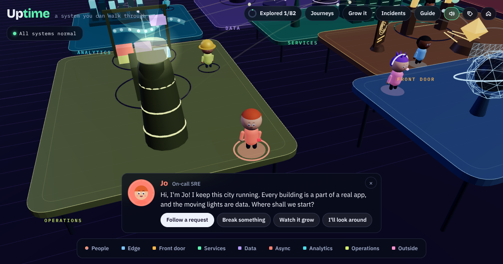

# Uptime

**A living system architecture in 3D. Fly through it, open any component, follow requests, grow it to a hundred million users and break things to see what happens.**

Live: https://kate1819.github.io/uptime/

## What you can do

- **Look around.** Drag to orbit, right-drag or two fingers to pan, scroll or pinch to zoom.
- **Open any of 27 components**, from DNS and the CDN to shards, queues and observability. Each card has three short tabs: what it does (with what goes in and out), the choices and trade-offs, and what happens if it fails.
- **Take things down.** The health panel and the traffic in the city show what users would feel, and the card explains how real systems survive it.
- **Journeys.** Follow eight requests step by step: opening the app, posting a photo, scrolling a feed, sending a chat message, paying, searching, surviving a bad deploy, and counting everything for analytics.
- **Grow it.** Eight stages, from one server for 100 users to a hundred million users.
- **Talk to the people.** Eight cartoon characters live in the city: a user, a developer, an on-call engineer, a security engineer, a data engineer, a platform engineer, an analyst and a support lead. They wander their districts, chat in speech bubbles, walk along with each journey and look worried during an outage. Tap one to ask questions, and their answers lead into journeys, real incidents or the parts they look after.
- **See the data.** Every journey step shows what travels (HTTP and JSON, gRPC, SQL, events, files, DNS) with a sample payload, and every component lists what it takes in and sends out. Traffic in the city is coloured by data type.
- **Incidents.** Start a surprise outage: get paged, read the dashboards, find the failing part, choose the right fix and read the postmortem. Or replay eleven real outages and cyber attacks from 2012 to 2024, as publicly reported.
- **Field guide.** Fourteen architecture styles (layered, microservices, event-driven, CQRS, event sourcing, serverless, hexagonal, DDD and more) and eleven big ideas (CAP, consistency, latency numbers, availability nines, back-of-envelope maths, idempotency and others). Each one lights up the parts of the city it relies on.

## About

The city is organised in districts: the edge, the front door, services, data, async, analytics, operations and the outside world. Components are not drawn to scale, and the health meters are a simplified picture of how the parts depend on each other.

Everything is one `index.html` file. The 3D scene uses three.js, and the music and sound effects are generated in the browser, so there are no audio files.
